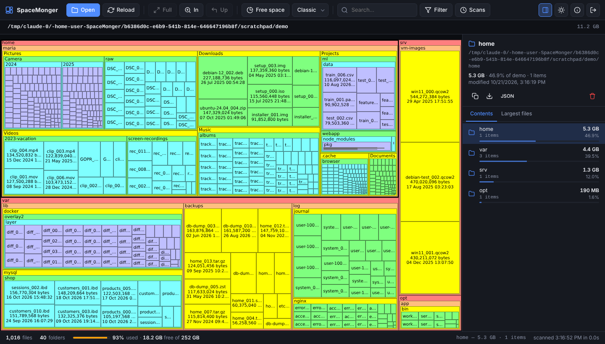

# SpaceMonger

Web-based disk space analyzer for Linux. Scans a filesystem and shows it as an
interactive squarified treemap, so you can see at a glance where the space went.
Single static binary, no dependencies, dark and light themes.

Inspired by the classic SpaceMonger for Windows.



## Features

- Squarified treemap in the classic SpaceMonger style: the original 16-colour palette by
  depth, touching tiles with thin outlines, folder header strips, and name / exact size in
  bytes / date in every file cell that has room; single-click selects, double-click zooms in
- **Colour modes**: *Classic* (by depth), *By type* (media, archives & disk images, logs &
  databases) and *By age* (older files stronger), with a legend
- **Details panel**: contents of the current folder sorted by size, the largest files
  anywhere below it, full path with copy button
- **Search** by name and **filters** by extension, minimum size and age; matches are
  highlighted or everything else is hidden from the layout
- **Scan history**: the last N scans stay in memory; **compare** two scans of the same
  path to see what grew, shrank, appeared or disappeared
- **Delete** files and folders from the UI (off by default, see Security notes)
- **Export** any folder as CSV or JSON
- Parallel scanner with an **exclude list** (paths or name patterns)
- Real on-disk usage (`st_blocks`): sparse files, transparent compression (btrfs, ZFS)
  and hard links are accounted for, with an apparent-vs-actual summary bar
- Stays on one filesystem: skips other mount points, `/proc`, `/sys`, symlinks, `.zfs`
- Live scan progress over Server-Sent Events, cancellable at any time; reloading the
  page restores the last scan instantly
- Password protection **on by default**, rate-limited login, 24h sessions, logout,
  optional HTTPS
- Dark / light theme (follows the system, toggle in the toolbar)
- Single ~10 MB binary with the UI embedded; runs as a systemd service

## Quick install

```bash
curl -fsSL https://raw.githubusercontent.com/toshko37/SpaceMonger/main/install.sh | sudo bash
```

The installer prints the generated login password. The UI is at
**http://localhost:4322** and reachable from the local network.

Uninstall:

```bash
sudo bash /opt/spacemonger/uninstall.sh
```

## Configuration

`/opt/spacemonger/settings.json`:

```json
{
  "port": 4322,
  "bind": "0.0.0.0",
  "auth": { "enabled": true, "password": "changeme" },
  "tls": { "cert": "", "key": "" },
  "exclude": ["/var/lib/docker", "node_modules", "*.tmp"],
  "scanWorkers": 0,
  "historySize": 5,
  "allowDelete": false,
  "releaseAfter": "30m"
}
```

| Key             | Meaning                                                             |
|-----------------|---------------------------------------------------------------------|
| `port`          | TCP port to listen on                                               |
| `bind`          | `0.0.0.0` for the whole LAN, `127.0.0.1` for this machine only      |
| `auth.enabled`  | Require the password. Leave on unless the host is otherwise isolated |
| `auth.password` | Login password. If empty while auth is enabled, one is generated and logged |
| `tls.cert/key`  | PEM certificate and key; when both are set the server speaks HTTPS  |
| `exclude`       | Skip these while scanning: absolute paths, or glob patterns matched against names |
| `scanWorkers`   | Concurrent directory readers; `0` = number of CPUs (2–16)           |
| `historySize`   | Completed scans kept in memory for history and compare (1–20)       |
| `allowDelete`   | Enable the Delete button. Off by default                            |
| `releaseAfter`  | Drop stored scans and return memory to the OS after this long without activity (`"30m"`, `"2h"`; `"0"` = never) |

### Memory use

Each scanned file or folder costs about 100 bytes while a scan is stored, so a
root filesystem with 2 million entries holds roughly 200 MB per stored scan,
times `historySize`. After `releaseAfter` of inactivity the scans are dropped
and the process returns to about 10 MB; the next visit simply rescans. On
small machines use `"historySize": 1` and a short `releaseAfter`.

The tree is written to the browser node by node, so sending it needs no extra
memory regardless of its size.

Restart after changes: `sudo systemctl restart spacemonger`.

The binary also accepts `-settings /path/to/settings.json`.

## Security notes

SpaceMonger runs as root (it has to, to read every directory) and exposes the
names and sizes of all files on the scanned filesystem. Keep auth enabled when
`bind` is `0.0.0.0`. Login attempts are limited to 5 per minute per IP. Set
`tls.cert` / `tls.key` or put a reverse proxy in front if you expose it beyond a
trusted LAN.

**Deleting** is disabled unless `allowDelete` is `true`. Even then the server
only deletes paths that exist in a stored scan (so they were visible in the UI),
never the scan root, and never system directories such as `/`, `/etc`, `/usr`,
`/var/lib` or anything under `/proc`, `/sys`, `/dev`, `/boot`. Deletion is
immediate and permanent: there is no trash.

## Usage

| Control         | Action                                            |
|-----------------|---------------------------------------------------|
| **Open**        | Choose a mounted filesystem to scan (`O`)         |
| **Reload**      | Rescan the current path (`R`)                     |
| **Full**        | Back to the scan root (`Home`)                    |
| **In**          | Zoom into the selected folder (`Enter`)           |
| **Up**          | One level up (`Backspace` / `←`)                  |
| **Free space**  | Show free space next to the treemap               |
| Colour menu     | Classic / By type / By age (remembered per browser) |
| **Search**      | Highlight names matching the text (`/` to focus)  |
| **Filter**      | Extension, minimum size, modification age; optionally hide non-matching |
| **Scans**       | Previous scans: load, compare with the current one, forget |
| Details panel   | Contents / Largest files / Results tabs; copy path, export CSV or JSON, delete (`Del`) |
| Single click    | Select a cell or a panel row                      |
| Double click    | Zoom into a folder                                |
| `Esc`           | Deselect / close dialog                           |

## API

All endpoints except `/api/version` and `/api/auth` require a session cookie
when auth is enabled.

| Method | Path                 | Description                                          |
|--------|----------------------|------------------------------------------------------|
| GET    | `/api/auth`          | `{authRequired, authenticated}`                      |
| POST   | `/api/auth`          | `{"password": "..."}` → sets session cookie          |
| POST   | `/api/logout`        | Invalidate the session                               |
| GET    | `/api/config`        | UI-relevant settings (`allowDelete`, `historySize`, …) |
| GET    | `/api/mounts`        | Real filesystems from `/proc/mounts` with usage      |
| GET    | `/api/scan?path=/`   | SSE stream: progress events, then `{status:"done", id}` |
| GET    | `/api/data?id=`      | A stored scan with its tree (gzip); latest when `id` is omitted |
| GET    | `/api/scans`         | List stored scans; `DELETE ?id=` forgets one         |
| GET    | `/api/compare?a=&b=` | Size changes between two scans of the same path      |
| GET    | `/api/export?id=&path=&format=csv\|json` | Download a subtree                |
| POST   | `/api/delete`        | `{"id": "...", "path": "/abs/path"}` removes it from disk and the scan |
| GET    | `/api/version`       | Build version                                        |

A new scan request cancels any scan still running.

## Build from source

```bash
git clone https://github.com/toshko37/SpaceMonger.git
cd SpaceMonger
go build -o spacemonger .
./spacemonger            # creates settings.json and prints the password
```

Requires Go 1.22+. Run the tests with `go test -race ./...`.

Project layout:

```
main.go       server setup and routing
settings.go   settings.json loading / defaults
scanner.go    parallel filesystem walker (cancellable, hard-link and mount aware)
mounts.go     /proc/mounts parsing
auth.go       sessions, login rate limiting
store.go      in-memory history of completed scans, tree helpers
compare.go    diff of two scans
delete.go     guarded deletion
export.go     CSV / JSON export
stream.go     allocation-free JSON writer for large trees
idle.go       idle release and memory trimming
handlers.go   HTTP / SSE handlers, gzip
static/js/    UI modules (state, colors, treemap, nav, panel, filters, scan, history, app)
```

## Releasing

```bash
git tag v1.1.0
git push origin v1.1.0
```

GitHub Actions runs the tests, builds amd64 / arm64 / armv7 binaries and
attaches them to the release.

## Author

Todor Karachorbadzhiev — [app@techbg.net](mailto:app@techbg.net)

## License

MIT — see [LICENSE](LICENSE)
